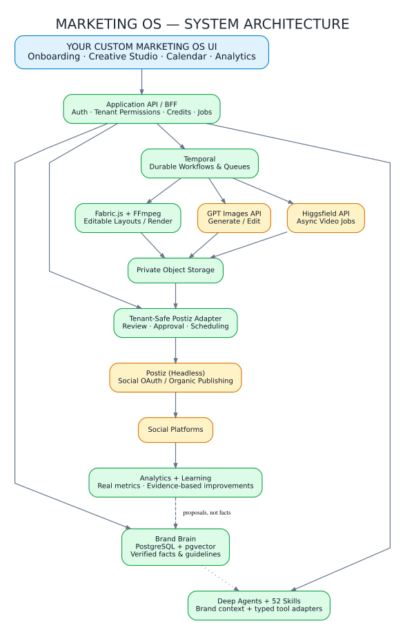
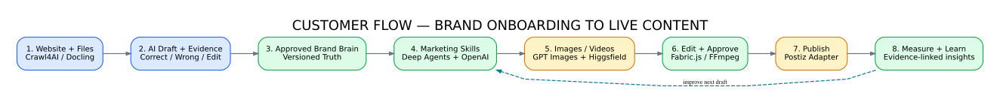
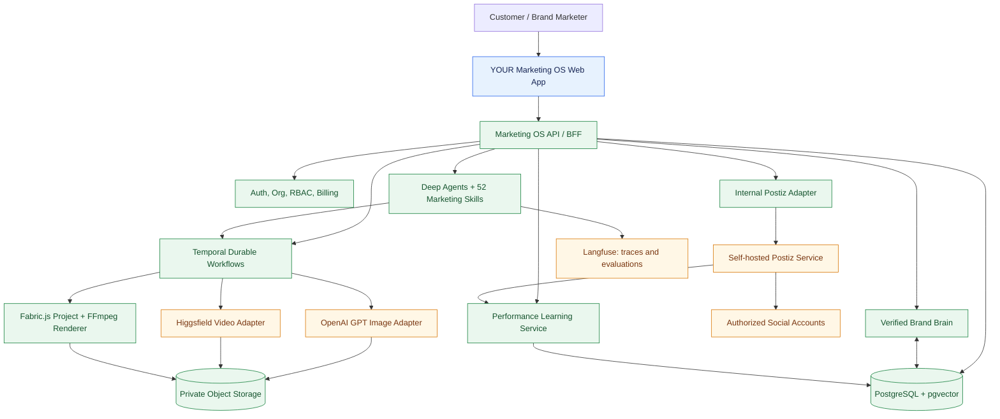
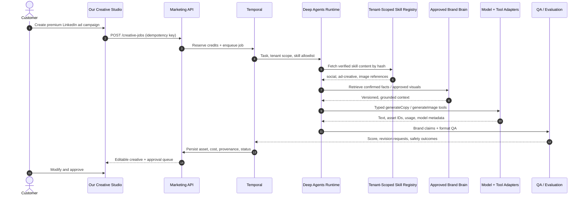
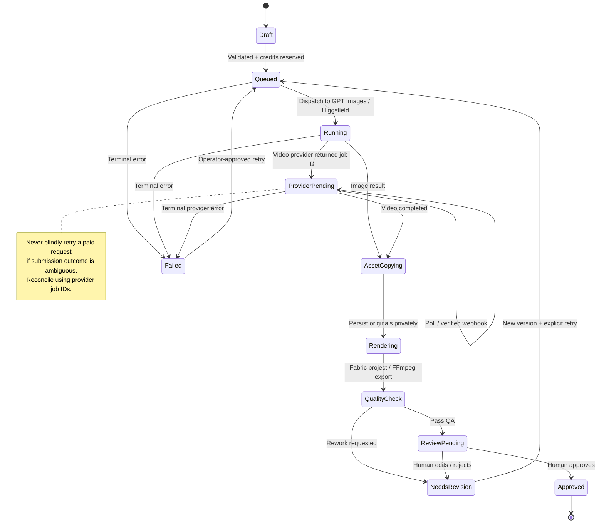
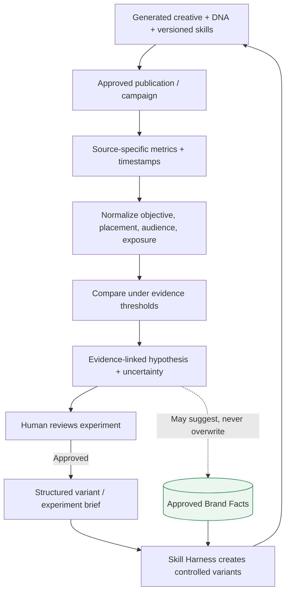
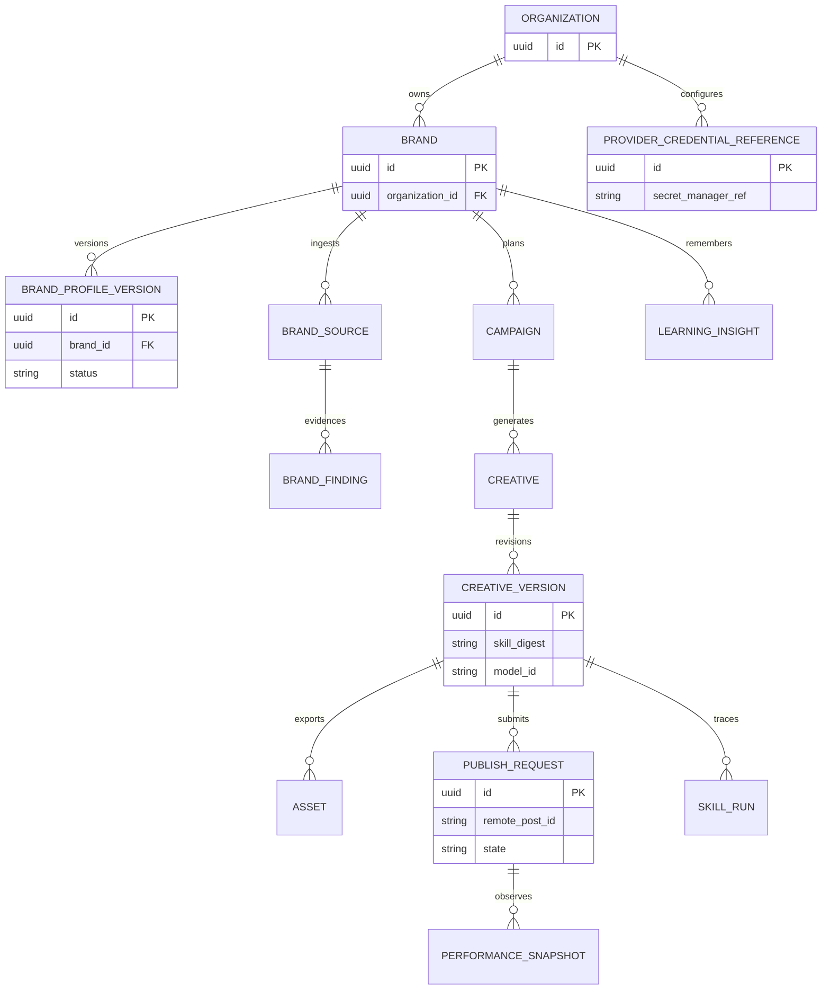
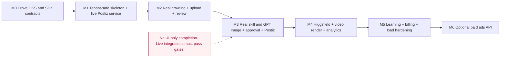
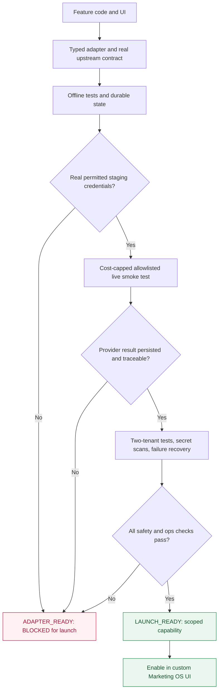
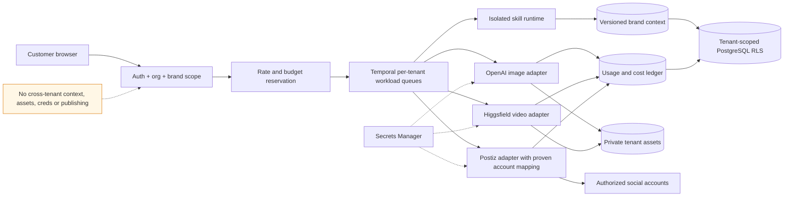

# Architecture diagrams — Marketing OS (living design)

**Audience:** Codex implementers, tech leads, security, operations. **Status:** Target architecture; diagrams are not evidence of implemented functionality. Each `.mmd` file under `diagrams/` is the editable source. Diagrams below render directly on GitHub.

**Critical operating rule:** The customer-facing application is ours. Deep Agents executes the owner's skill files. OpenAI GPT Images and Higgsfield are model providers through server-side SDKs. Postiz is a **headless organic publishing component**, subject to tenant isolation, supported API and licensing proof. There are no coding-agent processes in the customer runtime.

## Quick visual previews (SVG exports)

For eight rendered SVG + PNG diagrams, see **[Diagram gallery](diagrams/INDEX.md)**.

These scalable exports can be viewed without Mermaid support. The editable system-of-record diagrams remain the `.mmd` files below.





**Read alongside:** [PRODUCT.md](PRODUCT.md), [INTEGRATION_FIRST_BUILD.md](INTEGRATION_FIRST_BUILD.md), [CONFIGURE_AND_LAUNCH.md](CONFIGURE_AND_LAUNCH.md), [AGENTS.md](AGENTS.md).


## 1. System context and component ownership

Blue: our customer surface. Green: product-owned services and state. Amber: external/dependency boundaries. The graphic intentionally separates text/creative workflows, external model APIs, and publishing.

[Editable Mermaid source](diagrams/00-system-context.mmd)



## 2. Trust, security and tenant boundaries

No browser-to-provider or browser-to-Postiz credentials. Web content, uploads, and imported skills are untrusted inputs. Authentication and row/asset authorization must be enforced server-side on *every* access.

[Editable Mermaid source](diagrams/01-trust-boundaries.mmd)

```mermaid
flowchart LR
  subgraph browser[UNTRUSTED: Customer Browser]
    web[Custom Web UI]
  end
  subgraph edge[TRUSTED: API Edge]
    auth[Auth, CSRF / RBAC, Tenant Scope]
    bff[Application API]
  end
  subgraph internal[TRUSTED: Private Network / Workers]
    vault[Secrets Manager]
    db[(Brand Data / RLS)]
    skills[Isolated Skill Runtime]
    media[Media Workers]
    pub[Postiz Adapter]
    postiz[Isolated Postiz Instance(s)]
  end
  subgraph outside[EXTERNAL / UNTRUSTED]
    sites[Brand Websites + Files]
    models[OpenAI + Higgsfield]
    social[Social Platform APIs]
  end
  web -->|Authenticated API only| auth --> bff
  bff -->|Tenant-scoped| db
  bff --> skills
  bff --> media
  bff --> pub
  skills -->|Read-only brand context| db
  sites -->|Sanitized ingestion; no instruction authority| skills
  vault -.->|Server only| skills
  vault -.->|Server only| pub
  vault -.->|Server only| media
  media -->|Server-side HTTPS| models
  pub --> postiz --> social
  classDef caution fill:#fff3d6,stroke:#c47a0b;
  class web,sites caution;
```

## 3. Onboarding and brand verification

Website and optional guidelines feed draft findings with citations. Correct/Wrong/Edit and conflict resolution precede immutable approval; crawl and parsing continue asynchronously without blocking first value.

[Editable Mermaid source](diagrams/02-onboarding-sequence.mmd)

```mermaid
sequenceDiagram
  autonumber
  actor U as Brand Owner
  participant UI as Marketing OS UI
  participant API as Marketing API
  participant T as Temporal
  participant Crawl as Crawl4AI
  participant Docs as Docling
  participant Brain as Brand Brain DB
  U->>UI: Enter website (or skip)
  UI->>API: POST /brands/onboarding
  API->>T: Start bounded discovery workflow
  T->>Crawl: Crawl allowed public pages
  Crawl-->>T: Pages + source metadata + images
  T->>Brain: Draft field findings + evidence
  API-->>UI: Partial draft + crawl coverage
  U->>UI: Upload PDF/PPTX/other guidelines (optional)
  UI->>API: Register signed upload
  API->>T: Parse document job
  T->>Docs: Parse text, page/slide visuals
  Docs-->>T: Structured text + evidence pointers
  T->>Brain: Merge findings; create conflicts
  UI->>API: GET findings and conflicts
  API-->>UI: Suggested facts + provenance
  loop Each high-impact or uncertain field
    U->>UI: Correct / Wrong / Edit
    UI->>API: PATCH finding decision
    API->>Brain: Persist decision + audit event
  end
  U->>UI: Approve brand profile
  UI->>API: POST /brands/{id}/activate
  API->>Brain: Create immutable approved version
  API-->>UI: Brand Brain active; ready to create
```

## 4. Skill Harness runtime

Skill documents are versioned by content hash and loaded via a tenant-scoped virtual backend. Skills provide instructions; only allowlisted typed tool adapters may perform network/model execution.

[Editable Mermaid source](diagrams/03-skill-harness-sequence.mmd)



## 5. Creative generation job states

A video provider job is not the final export. Persist external IDs, safely reconcile uncertain submissions and move through media copy, rendering, QA and user approval before publishing.

[Editable Mermaid source](diagrams/04-creative-async-state.mmd)



## 6. Publishing and status reconciliation

A scheduled post is not necessarily a published post. Authorization, remote-ID mapping, deduplication, webhook/poll reconciliation and tenant isolation are release blockers.

[Editable Mermaid source](diagrams/05-publishing-sequence.mmd)

```mermaid
sequenceDiagram
  autonumber
  actor U as Brand Owner
  participant UI as Our Calendar / Approval UI
  participant API as Marketing API
  participant DB as Approval and Publish Ledger
  participant PUB as Tenant-Safe Postiz Adapter
  participant P as Self-hosted Postiz
  participant SOC as Social Provider
  U->>UI: Approve creative + schedule time
  UI->>API: Request schedule with idempotency key
  API->>DB: Check org, role, brand, asset approval
  alt Not allowed / wrong tenant
    DB-->>API: DENY
    API-->>UI: Error; no publish
  else Approved
    API->>DB: Reserve unique publication operation
    API->>PUB: Tenant-scoped schedule request
    PUB->>P: Upload asset and create post (verified API)
    P-->>PUB: Remote post ID / scheduled status
    PUB->>DB: Map tenant + account + remote ID
    DB-->>UI: Scheduled; final publishing not implied
    P->>SOC: Publish at requested time
    SOC-->>P: Publish result
    P-->>PUB: Webhook or polling result
    PUB->>DB: Reconcile actual publish status
    API-->>UI: Published / failed / unknown
  end
```

## 7. Continuous performance learning

Evaluation of a generation is distinct from outcomes of publication. Evidence-driven insights propose tests but never modify owner-approved brand facts or make unsupported causal claims.

[Editable Mermaid source](diagrams/06-learning-loop.mmd)



## 8. Deployment for growth

Autoscale frontend/API/intelligence/media separately; run Postiz under a proven tenant-isolation strategy. Thousands-of-customers readiness depends on measured load, quotas, vendor access, cost budgets and incident handling.

[Editable Mermaid source](diagrams/07-deployment-scale.mmd)

```mermaid
flowchart TB
  customer[Web and mobile users] --> cdn[CDN / WAF / TLS]
  cdn --> web[Stateless Next.js replicas]
  web --> api[Stateless API replicas]
  api --> pg[(Managed PostgreSQL + pgvector / RLS)]
  api --> redis[(Redis Cache / Rate Controls)]
  api --> obj[(S3 / R2 Private Buckets)]
  api --> tq[Temporal cluster + namespaces]
  tq --> w1[Ingestion workers: Crawl4AI + Docling]
  tq --> w2[Intelligence workers: Deep Agents]
  tq --> w3[Media workers: FFmpeg]
  w2 --> oai[OpenAI APIs]
  w2 --> hf[Higgsfield API]
  w3 --> obj
  api --> postiz[Postiz Adapter / Tenant Isolation Boundary]
  postiz --> pz[Self-hosted Postiz deployment(s)]
  pz --> social[Social networks]
  api --> trace[OpenTelemetry + Langfuse]
  w1 --> trace
  w2 --> trace
  w3 --> trace
  policy[Autoscale by workload; enforce per-tenant limits; prove scale by realistic load tests]
  api -.-> policy
```

## 9. Core data ownership

Our application owns organizations, brand facts, creatives, approval and learning. Postiz owns its own tables; only references to remote identifiers belong in our data model.

[Editable Mermaid source](diagrams/08-data-ownership.mmd)



## 10. Backend-first build order

Each stage is gated by customer-visible functionality *and* real behavior. UI-only screenshots are not shippable milestones.

[Editable Mermaid source](diagrams/09-build-order.mmd)




## 11. Release readiness and live-proof gate

[Editable Mermaid source](diagrams/10-release-readiness.mmd)




## 12. Image, video and skill provider operations

[Editable Mermaid source](diagrams/11-provider-operations.mmd)

```mermaid
sequenceDiagram
  autonumber
  actor U as Customer
  participant UI as Our Creative Studio
  participant API as Tenant-Safe API
  participant T as Temporal Worker
  participant S as Skills + Brand Brain
  participant O as OpenAI Image Adapter
  participant H as Higgsfield Video Adapter
  participant AS as Private Asset Store
  participant QA as Render + QA
  U->>UI: Request on-brand static and video ads
  UI->>API: Submit creative brief and approval policy
  API->>T: Reserve credits; enqueue immutable job
  T->>S: Load approved brand and allowed skills
  S-->>T: Structured prompts and visual constraints
  par Image production
    T->>O: Generate image (server-side key)
    O-->>T: Real asset bytes and usage metadata
  and Video production
    T->>H: Submit video model request
    H-->>T: Provider job ID
    loop Reconcile by poll or verified callback
      T->>H: Fetch actual job status
      H-->>T: Pending / success / failed
    end
  end
  T->>AS: Copy provider media to private storage
  T->>QA: Build editable project and evaluate
  QA-->>API: Versioned render, QA and cost
  API-->>UI: Persisted preview / edit / reject / approve
  U->>UI: Approve final version
```


## 13. Tenant isolation, budgets and runtime policy

[Editable Mermaid source](diagrams/12-tenant-and-cost-controls.mmd)



**Release rule:** Follow [NO_FAKE_FEATURES_RELEASE_GATE.md](NO_FAKE_FEATURES_RELEASE_GATE.md). Diagrams are design intent, not proof of integration.
